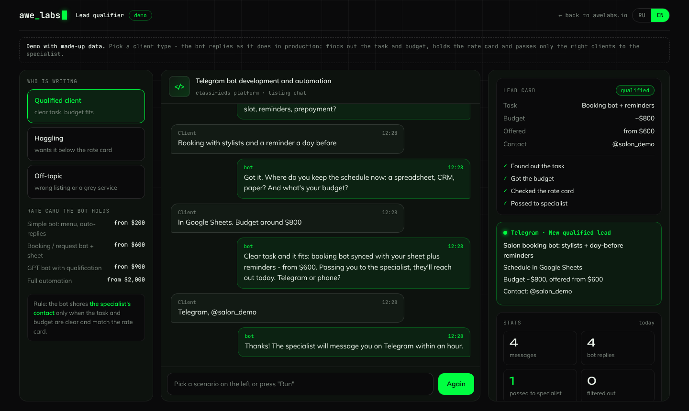
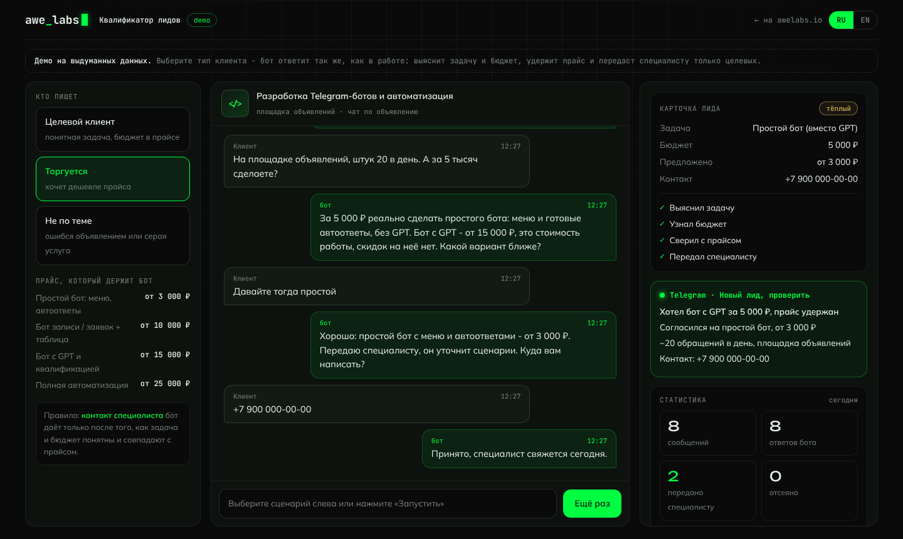

# AweLabs - Lead qualifier for classifieds (demo)

**Live demo:** https://awelabs.io/demo/leads/

[English](#english) · [Русский](#русский)

## English

A front-end demo of an AI bot that answers enquiries on a classifieds listing instead of the specialist and passes on **only the right clients**.

> This repository is a **demo on made-up data**. Clients, contacts and dialogues are fictional. The production bot code is not published.

### What the real bot does
- **Finds out the task first** - asks what exactly is needed before sharing any contacts.
- **Checks the budget** - compares it with the rate card and filters out off-target requests automatically.
- **Holds the rate card** - offers a cheaper scope instead of a discount, never haggles below the price.
- **Declines grey services** politely and suggests legal alternatives.
- **Hands over qualified leads** - an instant Telegram notification to the specialist with the task, budget and contact.
- **Daily stats** - messages, bot replies, leads passed on, filtered out, chats left unanswered, average reply time.
- **Greets once per day**, not once per chat, in the client's language.

### Scenarios in the demo
| Scenario | What happens |
|---|---|
| Qualified client | Task and budget fit - the lead goes to the specialist |
| Haggling | Wants it below the rate card - the bot holds the price and offers a simpler scope |
| Off-topic | Wrong listing or a grey service - politely declined, the specialist is not disturbed |

### About the demo
- One static `index.html`, no build, no backend.
- RU / EN.

---

## Русский

Фронт-демо AI-бота, который отвечает на обращения по объявлению вместо специалиста и пропускает дальше **только целевых клиентов**.

> Репозиторий - **демо на выдуманных данных**. Клиенты, контакты и диалоги ненастоящие. Код рабочего бота не публикуется.

### Что умеет настоящий бот
- **Сначала выясняет задачу** - уточняет, что именно нужно, прежде чем давать контакт.
- **Проверяет бюджет** - сверяет с прайсом и отсекает нецелевые запросы автоматически.
- **Держит прайс** - вместо скидки предлагает объём попроще, ниже цены не торгуется.
- **Вежливо отказывает в серых услугах** и предлагает легальные альтернативы.
- **Передаёт целевых** - мгновенное уведомление специалисту в Telegram: задача, бюджет, контакт.
- **Статистика за день** - сообщения, ответы бота, переданные лиды, отсеянные, чаты без ответа, среднее время ответа.
- **Здоровается раз в день**, а не один раз за чат, на языке клиента.

### Сценарии в демо
| Сценарий | Что происходит |
|---|---|
| Целевой клиент | Задача и бюджет в прайсе - лид уходит специалисту |
| Торгуется | Хочет дешевле прайса - бот держит цену и предлагает объём попроще |
| Не по теме | Ошибся объявлением или серая услуга - вежливый отказ, специалиста не беспокоят |

### О демо
- Один статичный `index.html`, без сборки и бэкенда.
- RU / EN.

---

**AweLabs** - automation studio · [awelabs.io](https://awelabs.io) · [t.me/awe_labs](https://t.me/awe_labs)
